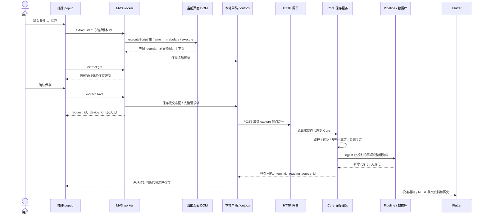
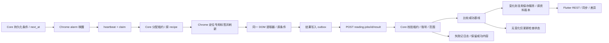

# 网页采集数据接口与后端交接说明

**接口索引 ID：** IC-BROWSER-DATA-HANDOFF-001

**文档版本：** v1.0（现状交接，不新增接口）

**核对日期：** 2026-11-17（Asia/Shanghai）

**代码基线：** `06065c6`，Chrome 扩展 `0.13.1`，Manifest V3

**维护边界：** 插件／网页采集 → Core 后端 → Flutter 工作台

按四节汇报模板交接时，使用[正式接口报告](browser-extraction-interface-report-v1.md)；本文件保留完整数据流、源码索引和实现边界，供深入核对。

本文件按照 [接口模板](template.md) 汇总当前可执行契约。字段以本基线源码为准；旧文档中的“仅快照”“默认手动”“关闭原页后重读”等描述，需要结合后续的 `reading` 和专用标签页扩展阅读。当前新 UI 默认请求专用标签页周期检查，仍可选择只保存一次。

本次交接仅核对源码、整理文档和离线校验合成请求，没有修改业务代码、触发真实网站采集、写入业务数据库或重启服务。历史验收记录不作为本次实测结果。

## 1. 接口概述

### 1.1 已实现到哪一层

| 数据／能力 | 当前实现 | 后端实际收到什么 |
|---|---|---|
| 浏览器加载 HTML 并执行网页脚本 | 由 Chrome 完成 | 不是原始 HTTP HTML 响应 |
| 渲染 DOM 读取 | **已实现，是当前采集入口**；主 frame 的内容脚本读取 DOM、文本、链接和必要原文属性 | 匹配后投影的 JSON，见三类保存请求 |
| 完整 HTML 字符串导出 | 当前插件主流程未实现 `outerHTML/innerHTML` 上传 | 没有 `html` 字段 |
| 完整 DOM 树序列化 | 未实现 | 没有节点全集、父子树、样式或全属性快照 |
| AX／CDP／OCR | 当前正式插件不使用 | 没有 AX tree、AX node ID、图像或 OCR 文本 |
| 普通网页提取 | 已实现通用 DOM 片段读取；已知校园站点优先使用专用适配器 | `fragments[]` 整组资料 |
| 校园原生事项 | 已实现指定页面类型及原生身份校验 | `targets[]`；完整且身份明确的事项 |
| Moodle Timeline | 已实现当前已加载活动摘要整组保存 | `collection_type=timeline_summary`，不是完整作业 |
| 周期重新读取 | 已实现 Core 租约调度＋Chrome 专用页刷新和同条件提取 | 新的匹配快照、账号绑定键、任务结果 |
| Cookie 导出／上传 | 当前插件未实现，也不是现行方案 | 不上传 Cookie、学校密码或浏览器存储全集 |
| Python 直接读取 HTML | 仓库另有历史 collector，用自研 HTTP＋BeautifulSoup/lxml 解析响应 | 解析后的 `Snapshot` 经总线进入 Pipeline；与插件链路独立 |

准确说法是：**“已实现从当前已加载的渲染 DOM 提取用户条件命中的文本和原文元数据，以 JSON 交给后端。”** 不能称为“已把整个网页 HTML／DOM 树交给后端”，也不能据此承诺所有网站均可可靠监测。

### 1.2 模块及责任

| 项目 | 现有责任 |
|---|---|
| 发送模块 | popup 控制器、`PageExtractionService`、`DomPageReader`、站点适配器、持久 outbox、重读执行器 |
| 接收模块 | Core 的 `BrowserMonitorService`、`WebCaptureService`、`TimelineCaptureContract`、`ReadingSourceService` |
| 接口用途 | 保存明确预览过的匹配内容，关联原条件来源，重新检查并更新原资料版本 |
| 通信方式 | 扩展内 `chrome.runtime` 消息；内容读取 `chrome.scripting.executeScript`；插件到后端 HTTP JSON＋Bearer |
| 插件负责 | 授权、DOM 范围与候选、原文、原生定位上下文、持久提交、Chrome 会话重读 |
| 后端负责 | Campus Radar 鉴权、身份／去重、字段处理与摘要、持久化、唯一调度、版本比较及投递 |
| Flutter 负责 | 资料与个人状态管理、信息源／检查状态、来源链接、变化展示 |

后端接手后应以已存在的三类入站 DTO 为处理入口。不要让业务处理依赖 popup 状态、Chrome `tabId`、DOM 节点对象或插件本地草稿。

## 2. 通信协议与端到端链路

### 2.1 首次提取、预览与保存



条件输入和预览本身不调用采集内容保存端点；可能有 `/api/me`、`capture-context` 等身份／控制查询。只有明确保存，匹配正文才进入采集 POST。保存使用冻结预览，不在点击保存时静默改成另一份网页内容。

### 2.2 周期检查的数据方向



Core 是调度责任方。插件每分钟 alarm 负责尝试领取，不自行生成每条规则的业务周期。新模式刷新仍打开的专用监测页，同页最多 10 条租约共用一次刷新、各自提取与确认。工作台页可关闭；Chrome、扩展、专用监测页及本地后端须可运行。Cookie 由 Chrome 自动按原站规则使用，不保证不会过期。

### 2.3 HTTP、鉴权与信封

本地典型入口 `http://localhost:8080`，网关 `/api/*` 转发 Core（默认 8081）。插件配置的 `config.server` 是网关 base URL；后端同事不应让插件直接写数据库。端口和部署地址以启动配置为准。

```http
POST /api/v1/web-captures HTTP/1.1
Content-Type: application/json
Authorization: Bearer <Campus Radar token>

{ "schema_version": 1, "request_id": "...", "device_id": "...", "...": "见字段表" }
```

- 登录 `POST /api/auth/login` 输入 `{email,password}`，输出 `{token,user}`；`GET /api/me` 返回用户对象。这两类响应没有 v1 采集信封。
- 插件 `fetch` 使用 `credentials:'omit'`。Bearer 是 Campus Radar 登录令牌，与原站 Cookie／学校登录互相独立。
- owner 由服务器鉴权结果确定，不接收请求体中的 `user_id/owner_id` 作为授权依据。
- v1 采集／检查成功响应包含 `schema_version:1,ok:true`；契约错误通常为 `{schema_version:1,ok:false,error}`，部分带 `message`。401 等公共鉴权／网关错误沿原 API `{error,message}`，不要强求所有失败具有相同信封。
- Content-Type 非 JSON、JSON 解析失败、空对象、缺少关联 ID、结果数量／类型不符，都不能作为保存成功。后端自身还会拒绝纯登录／loading 壳文本；这不是对所有网站登录状态的完整认证证明。
- API client 请求超时 12 秒；超时意味着没有确认，**不等于数据库未写入**，须沿同 request_id 查回执或原样重试。

### 2.4 版本、ID 与单位

| 名称 | 当前值／语义 |
|---|---|
| 扩展包版本 | `0.13.1`；manifest 声明 minimum_chrome_version=110，本次未做最低版本实机验证 |
| 内部 `extract.start.version` / `intent.version` | `2`，与网络 schema 无关 |
| 网络 `schema_version` | `1` |
| `targets[].recipe.version` | 当前 `2`＋snapshot；历史 `1`＋selector 保留兼容 |
| `reading.version` / `resident.version` / 账号证明 version | 各自为 `1`，不可混用 |
| `request_id` | 插件预览任务 UUID，也是首次保存幂等键；原生端点服务器允许 1–100 字符，集合端点严格要求规范 UUID 字符串 |
| `candidate_id` | 单次批次内唯一的关联键，如 candidate-1；不是持久业务身份 |
| `capture_id` | 后端集合 UUID，不是 DOM ID 或原站事项 ID |
| `item_id` / 保存回执 `source_id` | Core 资料 ID／底层 sources 表 ID |
| `reading_source_id` / reading-job 的 `source_id` | **reading_sources 规则 ID**；不能与上一行 source_id 混用 |
| `monitor_id` | 原生 browser_monitors ID；recipe v2 的 supported=false 不代表新的 reading 来源不能监测 |
| `device_id` | Chrome 安装标识，当前插件生成 UUID；后端按非空字符串≤100 接收，不是账号或 Cookie |
| `revision` | 来源配置修订号；修改、删除、恢复、重新激活会使旧租约失效 |
| `capture_generation` | 用户账号级采集代次；永久清理后提升，令旧预览失效；不是内容版本 |
| `observed_at` | 浏览器 UTC epoch **毫秒**，number；必须有限、>0、最多超前服务器 5 分钟；没有最早观测时间下限 |
| 数据库／API 的 `*_at`、`expires_at` | 服务器 UTC epoch **秒**，通常浮点数或 null；插件草稿内部时钟仍用毫秒 |
| `interval_s` | 秒，生产允许 1800／3600／7200；合成 loopback QA 可另设加速周期，不代表真实站点周期 |

字符上限不是 UTF-8 字节上限：浏览器 JS `.length` 为 UTF-16 code unit，后端 Python `len(str)` 为 Unicode code point，非 BMP 字符边界可能不同；不能将其统一写成“KB”。HTTP 解析层默认 body 上限 32 MiB，实际还受 outbox 与各 DTO 更小的限制约束。

### 2.5 仓库中另一条 HTML 链路（历史兼容，须单独理解）

`collector.Fetcher` 的自研HTTP客户端 → `Context.get`取得响应HTML文本 → `connectors/web.py` 的BeautifulSoup/lxml解析 → `Snapshot.to_dict()` → 二进制总线topic=`extract.result` → `services.start_core.on_extract` → 同一Pipeline → items／投递／Flutter。这条分支读取服务器HTTP响应，**不执行浏览器JavaScript、不等价于渲染DOM**；page_text/fetch_page也只输出标题及纯文本，没有把完整HTML作为业务接口传入Core。

collector的Snapshot字段为key/kind/title/url/body/course/deadline_at/published_at/attachments/requirements/attrs/alias_keys；消息外层为source_id/prev_status/status/error/error_kind/checked_at/complete/items/stats。它的complete可用于完整列表删除识别；**当前插件的匹配片段不是完整列表，不能套用complete=true删除未命中资料**。

旧调度器只选via_agent=0且type属于moodle/web/rss/teacher的来源。当前浏览器来源type=browser、via_agent=1，不应被它再次抓取。旧分支若有登录，会话来自其独立的后端credentials／SourceSession，不能推断已经取得Chrome Cookie。旧`/api/clips`及`/api/sources`仍兼容，但不是当前popup三类保存主流程；旧content/runtime.js即使克隆DOM，也只输出清理后的textContent。

## 3. 输入：浏览器内读取及三类保存契约

### 3.1 HTML、DOM 与提取范围

`DomPageReader` 注入 `content/scoped/*.js`，再调用 `CampusScoped.metadata/execute`，结果通过 executeScript 的可序列化值返回 worker；DOM 节点引用不会出浏览器调用。读取在默认 isolated world、`frameIds:[0]` 执行，没有页面框架内部变量／私有 API 接入。

校园专用规则先确认课程、活动、人员主体或具名区块，再读匹配正文；通用规则会在浏览器内遍历合格文本节点并匹配有限块，**并非不扫描页面**，但不会返回未匹配正文。通用匹配使用 NFKC、大小写、基础繁简规范化的字面包含，不是语义搜索。`content` 是正文／列表有限块，`title` 是标题／链接标题命中后对应块；校园专用规则目前只接受 content。

“已加载可见”指 DOM 及祖先未被 hidden、aria-hidden、display:none、visibility:hidden 等规则排除，**不等于只读取屏幕视口内像素**。滚动到视口外但仍在 DOM 的内容可能参与；虚拟列表未挂载项、未展开／未加载详情不会自动抓取。

通用提取支持开放 Shadow DOM 与 slot；不读 iframe、关闭 Shadow DOM、图片／canvas、文件正文、密码框、输入值或可编辑草稿。校园内容策略额外排除导航、页眉页脚、form、未授权 aside；通用提取没有同样的全局 nav/header/footer 黑名单，所以命中这些区域的普通文本仍可能成为片段，不能承诺已普遍消除页面噪声。

监测守卫会在浏览器内读取部分可见 select/search 状态用于视图哈希，并观察编辑忙碌状态；这些值不进入采集正文或后端。学生课表读取已选学期是明确的来源上下文，不能误写为“从不读取任何控件状态”。

| 阶段限制 | 当前值与处理 |
|---|---|
| DOM 稳定等待 | 最多 12 秒，250 ms 间隔，records/choices/navigation/coverage 连续三次相同；不保证整站异步数据已全部加载 |
| 通用遍历预算 | 节点访问≤150000、深度≤160、遍历文本≤3000000 字符，超限 page_too_large |
| 通用匹配预算 | 单片段≤20000、匹配文本累计≤500000、预览≤100；超限报错 |
| 明确保存 | 1–30 候选；集合格式化总文本≤20000；不静默截掉第 31 条 |
| 原生 raw | title≤300、text≤20000、每个 fields 值≤2000 |
| 本地预览 | 24 小时；同 owner 最多10条、全扩展20条、序列化总长≤2500000 |
| outbox | 最多60条、约2000000序列化字符；确认后删 body，紧凑确认元数据有界保留 |

### 3.2 扩展内部消息（不是 REST）

响应 `{ok:true,value}`／`{ok:false,error}`。仅扩展自身可信页面可发起；内容脚本无权读 token／草稿存储。所有正文保留在当前 owner（server＋uid）下。

| type | 输入 | 输出及语义 |
|---|---|---|
| `extract.start` | version:2、request_id、tabId、精确当前 url、query；可选 match_scope:content/title、choice:数字课程ID | `{id}`；持久 queued 后异步读取；不保存后端正文 |
| `extract.get` | id | 当前任务及 result、可选 submission |
| `extract.list` | 无 | `{tasks}` 草稿摘要，不含 result 正文 |
| `extract.verifyAccount` | id | 通用页账号证明 identity；另从账号控件读取，不取匹配正文邮箱作身份 |
| `extract.save` | id、原 query；通用页可带 source_binding；可选 monitoring | `{request_id,device_id}`；仅持久入队，不是服务端保存回执 |
| `extract.delete` | id | `{}`；仅清理插件预览，不删除后端资料 |

`monitoring` 仅接受 `{mode:"resident",interval_s:1800|3600|7200}`；当前 UI 默认携带。省略表示兼容只保存一次；当前带 v2 intent 的保存仍可关联手动 reading 来源。保存不能接收 UI 替换正文或候选子集，使用整组冻结预览；修改条件须重新提取。

### 3.3 读取结果与候选的字段清单

下面是浏览器内部对象，不可直接当成后端 DTO POST。

| 路径 | 类型 | 语义及去向 |
|---|---|---|
| snapshot.url/title/source/fixture | string | 当前URL／页面标题／moodle、student、fie、generic；fixture仅本地测试标记 |
| snapshot.account | object | state=public/known/unknown，native为页面观测账号；generic可含 probe；native在浏览器内加盐散列后从公开 result 移除 |
| snapshot.login/ready/frames | boolean/string/int | 登录页判定、document.readyState、iframe数量；诊断用，不作为后端完整网页数据 |
| snapshot.channel/observed_at | string/number | dom、观测毫秒时间；原生保存端点没有 observed_at 输入 |
| snapshot.records[] | array | `{entity_id,record_type,title,text,url,fields,complete,evidence}`，适配器可增 view、missing_fields、preview_reason、presentation、context |
| snapshot.intent | object | 原条件解释；见下表 |
| snapshot.choices / navigation | array | 同名课程确认项／已匹配入口；不会自动打开其他详情 |
| snapshot.coverage | object | current_rendered_view、匹配依据／数量；可含 regions、course_index、open_shadow_roots、frames_excluded等诊断，不是全站覆盖率 |
| snapshot.outcome / state / warnings | object/string/array | matched/no_match/navigation_required/needs_choice、任务状态及范围提示 |
| snapshot.extraction.body_reads | int | 有界内容读取次数，仅诊断，不含非匹配正文 |
| result.binding | object/null | `{adapter,origin,account_key}`；generic上传使用另外的 source_binding |
| result.save_mode | string optional | Timeline集合为 timeline_summary；普通原生候选不带该表示 |
| candidates[].candidate_id/entity_id | string/string或null | 批次键／可靠原生身份；通用片段和Timeline活动没有原生 entity_id |
| candidates[].record_type | string | detail、assignment、course_entry、page_section、timeline_event、contact_info、web_fragment等 |
| candidates[].raw | object | `{title,text,fields}`；规范化的原文投影，不是HTML |
| candidates[].url/context | string/object | 来源定位；generic context见3.5；适配器上下文见对应类型 |
| candidates[].evidence | array | 原文依据；当前记录通常一项；集合上传仅投影第一项，原生不上传该数组 |
| candidates[].completeness | string | detail / summary / fragment；原生上传没有此顶层字段 |
| candidates[].save_allowed/save_reason/missing_fields | boolean/string/array | 保存策略；只留本地预览，不是服务器已验证声明 |
| candidates[].presentation | object optional | group=courses/assignments/timeline/contacts/sections，region、matched_by、course_relation；仅UI分组，不上传 |
| candidates[].target | object/null | 原生保存 DTO；入口或仅预览候选为空，不能伪造为事项 |

`intent` 字段：`version:2,query,kind,target,keyword,fields,current,all`；通用还含 `mode:"literal",match_scope`。校园 kind 为 auto/assignments/timetable/notices/news/people。fields 表示邮箱、办公室等投影需求，不用于推测业务类型；choice 为用户明确确认的原生课程 ID。只有随 `reading.intent` 提交的解释才到后端。

### 3.4 A：校园原生事项 `POST /api/v1/captures`

| 字段 | 类型／必填 | 约束 |
|---|---|---|
| schema_version | int／是 | 1 |
| request_id / device_id | string／是 | 各1–100字符；当前插件用UUID |
| capture_generation | int／当前插件携带 | 当前用户代次，0..2^53-1；缺省0仅兼容从未永久清理账号 |
| binding | object／是 | adapter=moodle/student/fie，兼容manual；origin为同源HTTP(S)；account_key非空≤200，学校不能public |
| targets | array／是 | 1–30，批次candidate_id唯一 |
| targets[].candidate_id | string／是 | ≤200，回执逐项关联 |
| targets[].entity_id | string／是 | ≤200，格式 assignment:/notice:/person:/timetable:/manual: 后接无空白身份；不能用标题、内容hash或行号捏造 |
| targets[].locator | object／是 | url、frame_url、view；frame_url必须等于url，且与binding.origin同源 |
| locator.view | object／是 | 字符串键值，compact JSON≤2000字符；保留route/query以及学期、周次、节次、projection等上下文 |
| targets[].raw | object／是 | title非空≤300，text非空≤20000，fields字典默认{}；不是HTML |
| targets[].recipe | object／是 | 当前 `{adapter,version:2,strategy:"snapshot",entity_id,url,view}`；与locator及binding一致 |
| targets[].supported / enabled | boolean／是 | 当前均false；禁止把snapshot recipe交给旧monitor调度 |
| reading | object／当前主流程携带 | 见3.7；关联新条件来源，负责当前监测 |

`raw.fields` 白名单的**全部键**如下，值均为字符串、允许空、≤2000；来源无信息时不应编造：

| 类别 | 字段 |
|---|---|
| 类型与课程 | subtype、course、course_code、class_group |
| 课表原文上下文 | semester、week、weekday、period、location |
| 时间原文 | datetime_text、date_text、published_text、valid_until_text |
| 人员原文字段 | department、office、email、phone、role |
| 提交要求原文 | requirements |

白名单不等于每个适配器都已填充所有字段。当前Moodle作业常提供course/datetime_text；人员详情按所选字段提供；学生资讯可提供发布单位／发布时间原文。课表若缺可靠课次身份／日期上下文，适配器可能只允许预览。字段缺失不能据此推测日期。

**原生路径不上传候选的 evidence、presentation、coverage、missing_fields、完整度、页面标题和 observed_at。** 可用的来源定位是 locator／recipe；后端原始字段存 raw_fields。需要 DOM 证据或浏览器观测时间时，必须另行版本化扩展契约，本轮未实现。

此接口是逐项结果：单个target校验失败可返回failed，其他target继续保存；请求级契约错误／来源关联失败可使事务整体回滚。后端处理不能只检查HTTP200或results存在。

### 3.5 B：普通网页整组 `POST /api/v1/web-captures`

除外层控制字段 `reading/capture_generation` 外，集合内容对象严格接受下表九个键，未知键会拒绝，不能附加 `html/dom/metadata`。

| 字段 | 类型／必填 | 语义及约束 |
|---|---|---|
| schema_version | int／是 | 1 |
| request_id | string／是 | 规范小写UUID字符串；同owner幂等 |
| device_id | string／是 | 非空≤100；由background入队补充 |
| source | object／是 | **仅**url/title；url≤2048，HTTP(S)无用户名密码，title非空≤300 |
| query | string／是 | trim后1–200；原始用户条件 |
| match_scope | string／是 | content/title |
| observed_at | number／是 | 毫秒，见2.4 |
| source_binding | object／是 | 下述来源隔离声明 |
| fragments | array／是 | 1–30，candidate_id唯一；每项结构见下表 |

source_binding：`{kind:"public"|"labeled",label,identity?}`，label经NFKC、1–80字符。public的label固定“公开网页”，不得带identity；labeled可带账号控件证明。**公开表示原站登录要求声明，不是向其他用户公开资料**。所有该类资料仍按Campus Radar owner隔离。Gmail／QQ邮箱拒绝声明public。

可选identity仅接受 `{version:1,probe:"account-control-email-v1",account_key,display}`。account_key必须64位小写十六进制；display如 `s***@example.test`、≤100。它是扩展对账号控件的观测描述，不是OAuth令牌或服务端对原站身份的认证。普通标签、关键词、正文邮箱都不能作为账号证明。

| fragments[]字段 | 类型 | 约束 |
|---|---|---|
| candidate_id | string | 1–100，批次唯一 |
| title | string | 1–300；浏览器通用提取标题通常截取前200字符 |
| text | string | 1–20000，空白清理后的匹配块原文 |
| evidence | object | **仅**channel/locator/text；channel=dom，locator非空≤4000，text必须等于片段text |
| context | object | **仅**frame_url/boundary/completeness/matched_by |
| context.frame_url | string | 必须等于source.url；当前主frame |
| context.boundary | enum | paragraph/list_row/table_row/section/text |
| context.completeness / matched_by | string | 固定fragment／literal |

片段没有单独url、fields、entity_id或持久ID。来源链接是source.url；DOM locator只作依据，`::shadow`等标记可能不是可直接执行的CSS selector。后端格式化整组 `【片段 n】title\ntext`，总长≤20000；保存为一份clip/web_reference资料，不自动拆成多条事务。

known校园域名（Moodle、学生／资讯／课表、FIE、学校登录）不能走generic端点绕过专用校验。snapshot-only与resident对临时URL的处理不同，见7.3。

### 3.6 C：Timeline整组 `POST /api/v1/timeline-captures`

沿3.5集合字段，改变如下，未说明字段约束相同：

| 路径 | 当前要求 |
|---|---|
| collection_type | 额外必填，固定timeline_summary |
| source.url | `https://moodle.must.edu.mo/my/`；仅为脱敏／本地验证允许localhost/127.0.0.1的/my/或/capture/moodle-dashboard |
| source_binding | **不是**kind/label结构；严格为 `{adapter:"moodle",origin,account_key}`，禁止public/unverified |
| query / match_scope | 用户显式Timeline／时间线条件，content |
| fragments[] | 严格含candidate_id/title/text/url/fields/evidence/context |
| fragments[].url | 同源活动详情HTTP(S)链接；不含敏感凭据参数或action操作参数；不证明已读取详情 |
| fragments[].fields | 严格course/date_text/datetime_text三个字符串，各≤1000，缺失为空，保留日期／时间原文 |
| evidence | channel=dom，locator≤4000；text≤22000且包含片段text，可含日期分组原文 |
| context | 必须为 `{frame_url:source.url,region:"Timeline",completeness:"summary"}` |
| reading | 外部首次保存**必须**带，representation=timeline_summary，source=moodle、choice为空、view={}、intent.kind=auto、fields=[]且target明确Timeline／时间线 |

后端按title/text/url/fields排序格式化活动摘要，包含课程、日期原文、时间原文及详情链接，总长≤20000。整组为clip/timeline_summary，不伪造原站事件ID，也不生成assignment；日期不足不推断截止。课程入口和Support仅预览的限制不因这一例外自动放开。

### 3.7 保存请求的外层 `reading`

`reading`用于持久化原条件／来源上下文；它与capture_generation为传输控制信息。集合服务通过 `CaptureSnapshotProjector` 去掉这两个字段后验证内容，旧基线重读也采用相同投影；其他未知内容键仍拒绝。

| 字段 | 类型／必填 | 语义及约束 |
|---|---|---|
| version | int／是 | 1 |
| url/query/match_scope | string／是 | 与保存来源及原条件一致，url≤2048、query≤200 |
| source | enum／是 | generic/moodle/student/fie；与保存类型一致 |
| intent | object／是 | 内部意图version2，query必须一致，fields为字符串数组，compact JSON≤2000；只接受3.3列出的intent键 |
| choice | string／是 | ≤100，可空；课程歧义确认ID |
| view | object／是 | 字符串字典、compact JSON≤2000；共有projection/semester/week/weekday/period上下文（有值且各候选一致时冻结） |
| binding | object／是 | 严格adapter/origin/account_key；adapter等于source、同源 |
| source_label | string／可选 | ≤80、可空；generic必须与source_binding.label一致 |
| account_probe | object／可选 | generic已核对账号时 `{version:1,kind:"account-control-email-v1",display}`，必须与source_binding.identity一致 |
| representation | string／可选 | 当前仅timeline_summary，且仅Moodle显式Timeline集合 |
| resident | object／可选 | 见下表；缺省保留旧快照／手动重读语义 |

resident严格为 `{version:1,session_id,page_id,refresh:"reload",interval_s}`；session_id/page_id为规范UUIDv4，interval_s为1800/3600/7200。这些是**不透明引用**，不含Cookie、tabId、原始临时URL或Chrome控件哈希。

校园account_key由设备salt＋adapter＋原生账号SHA-256得到，公开FIE为public。generic无账号证明时reading.key可为unverified；只有已确认的resident单会话模式允许后台沿该绑定重读。服务器不能据此宣称已核实真实邮箱账号。一个owner/device/origin维持一套原站会话，可含多个页面／关键词规则；无法观察的账号切换是现有限制。

### 3.8 保存接口确认及查询

原生回执：`{schema_version:1,ok:true,request_id,results:[...]}`。每个成功项为 `{candidate_id,status:new|changed|unchanged,monitor_id,item_id}`；失败项为 `{candidate_id,status:"failed",error,message}`。顺序、数量、candidate_id必须对应请求。

两种集合回执：`{schema_version:1,ok:true,request_id,candidate_ids,results:[集合结果]}`。results恰好一项：`{candidate_id:"collection",capture_id,item_id,source_id,status:new|changed|unchanged,fragment_count,version}`。candidate_ids顺序覆盖全部提交片段；Timeline另有 `capture_type:"timeline_summary"`。

有reading且正常保存时返回正整数reading_source_id。resident保存另有 `monitoring:{state:"starting",mode:"resident",interval_s}`；它表示已请求启动，**并非首次检查成功**。新资料已保存与监测尚未成功可以同时成立。

| 查询 | 输出 |
|---|---|
| GET /api/v1/captures/{request_id} | 当前owner原生保存持久回执；不存在404 |
| GET /api/v1/web-captures/{request_id} | 当前owner通用保存回执；跨类型或不存在404 |
| GET /api/v1/timeline-captures/{request_id} | 当前ownerTimeline保存回执 |
| GET /api/v1/web-captures、/timeline-captures | `{schema_version:1,ok:true,collections:[...]}`；摘要id/title/url/version/updated_at/source_binding/fragment_count，不含正文 |

集合列表实现先从同owner底层集合取最近100行，再筛选capture_type；混合类型时某列表可能少于100条，不提供分页或全部历史导出。

## 4. 输出：后端接收、处理、存储和客户端

### 4.1 后端当前处理入口

`API.register`把三个服务的validate_reading、guard_reading、on_capture接到同一ReadingSourceService。一次有效保存事务关联内容、回执、条件来源和资料链接，不再走互不关联的clip/page证明闭环。

| 入站类型 | 当前投影到Pipeline的事项 |
|---|---|
| 原生assignment: | key=`browser:<monitor_id>`，kind=assignment；title/text→title/body，fields.course→course、requirements→requirements，全部fields→attrs.raw_fields |
| 原生课表subtype=timetable | kind=event，attrs.product_type=event，保留raw_fields并suppress_deadline；不凭周次补日期 |
| 人员／资讯等其他原生 | kind=notice；人员subtype=teacher_profile，不等于旧collector的teacher类型 |
| 普通网页集合 | key=`web:<capture_id>`，kind=clip，title=`query · source.title`（≤300），body为格式化片段；attrs.subtype=web_reference、web_capture保留完整集合元数据 |
| Timeline集合 | 同集合方式，attrs.subtype=timeline_summary、web_capture.collection_type=timeline_summary；summary而非完整作业 |

owner私有身份键由Pipeline加 `@<uid>/` 前缀；该key为后端内部标识，不要让插件构造或客户端依赖。

Pipeline已实现 `_scope → _find/_upsert → _enrich → diff/classify → _fanout/_deliver`：按稳定身份处理重复，生成摘要／facts，适用类型提取deadline，写items及item_versions，保留个人state，生成投递与seq。generic和Timeline设置suppress_deadline=true；原生课表也抑制deadline推断，原生作业等仍可走后端提取。当前不是只存原文的空管道。

Summarizer无完整配置时采用规则；同时设置GLEANER_LLM_BASE_URL/MODEL/API_KEY且正文≥80字符时，代码可调用外部模型（正文前4000字符＋标题），超时／解析失败回退规则。本次没有读取密钥或确认运行环境是否开启LLM；“具备实现”不等于“本次已调用”。后端接入处理应保留原文字段，不能把summary当原文。

### 4.2 数据落点及留存

| 表／存储 | 数据 | 交接注意 |
|---|---|---|
| chrome.storage.local extractionDrafts | 条件、冻结候选、原文依据、提交关联 | 24h有界草稿；未上传数据不能从Core补取 |
| intents / outbox | 待发完整JSON、重试状态；确认后保留精简回执 | 不作业务资料长期数据库 |
| residentSites / storage.session | 本地tabId、原始URL、epoch、视图哈希／账号指纹；Cookie仍由Chrome管理 | 后端只收到resident UUID引用 |
| browser_requests / web_capture_requests | owner/request_id、请求摘要和持久回执 | **不是原始请求体归档** |
| browser_monitors | 原生binding、recipe、last_raw、source/item关联 | 即使当前supported=false，也承载原生保存身份；不能据此判定reading未启用 |
| web_collections | 集合ID、owner、identity_key、source_id | 通用及Timeline共用表，查询按类型隔离 |
| sources / subscriptions | 底层私有type=browser来源与访问关联 | via_agent=1；不由旧Python collector重复抓取 |
| items | 当前body/raw_title等＋attrs.raw_fields或attrs.web_capture | 当前可消费原文／字段；body长度最多20000 |
| item_versions | 版本snapshot、changed_fields、重要性与时间 | 不是完整网页档案，见下文 |
| reading_sources | 原recipe、last_snapshot、revision、运行模式、成功／尝试时间、下次计划 | last_snapshot是当前成功内容基线，不是所有观测历史 |
| reading_source_items | 规则与已保存资料关联 | 删除／回收站需要通过生命周期接口处理 |
| reading_sessions / reading_pages | owner/device/origin及opaque session/page引用 | 不含原站Cookie |
| reading_devices / reading_jobs / reading_checks | 心跳、租约、结果摘要、检查日志 | 任务数据不是资料正文获取API |
| user_item_state | 已读、收藏、待办、hidden、note、deadline_override | 来源更新不得覆盖这些个人状态 |
| deliveries | 每用户seq、投递payload、版本 | 同步／补发记录，不是每次采集完整输入日志 |

版本实现限制：`Pipeline._snapshot`显式保存title/raw_title/deadline_at/url/course/summary/attrs，**没有独立body字段**。集合原文在attrs.web_capture.fragments内有副本；原生历史正文主要依赖changed_fields.body的前后值，没有通用的“按版本获取完整原始DOM／原始上传包”接口。证据／observed_at更新而内容未变时，集合当前attrs可刷新而不新增版本；不能把当前元数据当每次历史观测的不可变日志。

### 4.3 交给后端团队的数据消费接口

| 接口 | 内容与适用方式 |
|---|---|
| GET /api/feed | 当前owner收件箱摘要；支持cursor/kind/filter/q/limit，返回items及同步游标，正文需详情 |
| GET /api/items/{id} | 当前资料详情；包含body、source_fields或web_capture，以及browser_monitor／reading_source关联 |
| GET /api/items/{id}/versions | `{versions:[{version,changed_fields,important,change_note,detected_at}]}`；不返回完整snapshot |
| GET /api/sync?cursor= | 以每用户seq补投递，一次最多500；不是采集回执查询 |
| WebSocket /ws | 既有hello/seq/ack补发，投递类型item/change；见[同步协议](../protocols/rest-api-and-sync.md)与[WebSocket协议](../protocols/websocket.md) |
| GET /api/v1/reading-sources | 条件来源及关联资料摘要，见5.3 |

事项公共DTO由 `pipeline.item_public`生成：id、kind、course、title、raw_title、summary、url、deadline_at、published_at、version、deleted、source_id、first_seen_at、updated_at、attachments、requirements、channels、facts、category、change_note、important_change、summary_by、source_fields、web_capture；可有source摘要、state及score/priority/reasons。详情再加body及监测关联。这里的title/summary/deadline_at可能已是后端处理结果，应与raw_title/source_fields/web_capture.fragments原文区分。

原生source_fields等于attrs.raw_fields；web_capture为null或包含capture_id/source/query/match_scope/source_binding/account_state/observed_at/scope/completeness/monitoring/fragments，Timeline另有collection_type。`web_capture.monitoring=false`是该快照元数据的兼容值，**不能用于判断当前规则是否周期执行**；应读取reading_sources的mode/verified/paused/last_result/next_at。

推送链路为Pipeline → deliveries持久seq → Core BusHub的`u.<uid>` → 推送节点WebSocket（可另有MQTT精简通知）→ Flutter本地store。插件保存POST直接进入Core服务，不先经collector的extract.result。Core和Flutter也可用REST读取，无需新增后端处理消息队列才能收到现有数据。

## 5. 监测结果接口与状态

### 5.1 控制接口

以下均需Campus Radar鉴权、按owner隔离。响应均含schema_version=1/ok=true，错误例外见2.3。

| 方法与路径 | 输入 | 输出／效果 |
|---|---|---|
| GET /api/v1/capture-context | 无 | generation、resident_pages:[UUID]、reading_sources/monitors:[{id,revision}]、item_ids；不含URL／正文／Cookie |
| POST /api/v1/reading-devices/heartbeat | **仅**`{device_id}` | `{device_id}`；150秒内认为设备近期在线，不证明网站会话有效 |
| POST /api/v1/reading-jobs/claim | **仅**`{device_id}` | `{job:null}`或租约job；并非触发任意网页抓取 |
| POST /api/v1/reading-jobs/{job_id}/result | 见5.2 | `{job_id,status,result}`确认；保存成功结果后才清理outbox正文 |
| GET /api/v1/reading-sources | 无 | `{sources:[...]}`，当前可见资料关联来源，最多200行，无分页 |
| PUT /api/v1/reading-sources/{id} | **仅**`{revision,mode:manual|periodic,paused:boolean,interval_s}` | `{revision:旧值+1}`；撤销旧任务，同页规则联动；未verified不可直接启用periodic |
| POST /api/v1/reading-sources/{id}/activate | **仅**`{revision,interval_s}` | `{source_id,status:"queued"}`；首次实际刷新／重绑，未完成前不是成功 |
| POST /api/v1/reading-sources/{id}/check | **仅**`{revision,purpose:verify|check}` | `{source_id,status:"queued",job_id:已有任务ID或null}`；manual/paused仍可单次 |
| GET /api/v1/reading-sources/{id}/checks | 无 | `{checks:[{job_id,purpose,result,detail,checked_at}]}`，最近50条 |

配置及check/activate在同一page_id的规则间可联动；不同规则的内容结果与租约各自独立。claim返回job字段为id、source_id（规则ID）、device_id、revision、lease、expires_at（秒）、purpose、interval_s、recipe；purpose=verify/check/activate。可有companions数组，最多额外9项同页job，每项各自lease及结果POST。

租约180秒、同一未完成任务最多领取3次；设备有有效未完成任务时不再发新的批次。过期及worker恢复通过有界重试处理，不逐次补跑离线期间所有周期。插件的任务意图与结果outbox持久化，不能依赖worker一直存活。

### 5.2 `POST /api/v1/reading-jobs/{job_id}/result`

| 字段 | 类型／条件 | 约束 |
|---|---|---|
| schema_version | int／总是 | 1 |
| device_id / lease | string／总是 | 必须匹配当前owner任务 |
| revision | int／总是 | 匹配任务及当前规则修订 |
| status | enum／总是 | success或下表失败状态；**客户端不直接上报changed/unchanged** |
| account_key | string／success必填 | 与原reading.binding.account_key一致，未知单会话可为unverified |
| snapshot | object／success必填 | 按原类型构造；不是HTML／DOM全集 |
| resident | object／仅activate成功 | 必填resident描述符；非activate携带会拒绝 |

失败时请求必须只含前五个键，没有snapshot/account_key或任意error详情。成功时必须有account_key和snapshot；服务端严格校验确切键集合。

snapshot有三种形式：

- **原生**：`{binding,targets}`，targets沿3.4且recipe.version=2/enabled=false；视图与原recipe一致。
- **通用**：沿3.5的浏览器payload（含schema_version/request_id/source/query/match_scope/observed_at/source_binding/fragments，当前worker尚未补device_id）；后端以初始基线的device_id/source标题/身份重建并验证，只采纳新observed_at/fragments。
- **Timeline**：同上，增加collection_type，使用Timeline字段；不包含初次提交的reading/capture_generation。后端同样保留原集合身份。

集合snapshot.source.url/query/match_scope/source_binding必须与原基线精确一致；页面新title不会改变初始资料身份／标题。result请求不能借重读改URL、条件、标签、账号或owner。

后端把success解释为verified／changed／unchanged，回执status是changed／unchanged／failed；verified映射status=unchanged但result仍为verified。verify仅验证读取能力，不更新内容基线或last_success_at；activate/check实际成功才更新成功时间。changed通过原保存服务更新原资料，unchanged不增加内容版本。

| 可上报失败status | 含义 |
|---|---|
| need_login / account_unknown / account_mismatch | 需要登录／无法核对原账号／已知账号不符 |
| route_mismatch / view_mismatch | 页面URL或约定视图改变 |
| permission_denied / unsupported | 无权限／读取类型不支持 |
| render_timeout / selection_missing / no_match | 渲染超时／约定内容不在／无匹配，不是无变化 |
| preview_only / private_source_required | 结果不足以沿原契约保存／私人页不能声明公开 |
| tab_missing / tab_rebind_required / tab_ambiguous | 专用页关闭／会话代次需重绑／多个匹配页无法唯一选择 |
| user_busy / single_account_conflict | 检测到编辑延后／同origin会话绑定冲突 |
| worker_interrupted / failed | worker中断／未分类异常 |

权限、登录、账号、路由、视图、标签绑定等失效立即暂停／撤销verified；resident临时失败累计3次暂停；user_busy延后60秒且不增加失败计数。失败不覆盖成功快照或成功时间，零匹配不清空原资料。

有效租约提交了不合契约的结果时，HTTP422仍返回原错误；内容事务回滚后独立记录result_rejected、detail.error并结束任务／暂停规则。它是服务端终态，不是客户端允许上报的status。错误／过期租约不能借该逻辑改变来源状态。

### 5.3 来源列表的状态字段

sources[]包括id/device_id/revision/mode/interval_s/last_result/last_attempt_at/last_success_at/next_at/error/pending/paused/verified/recipe/match_count/items/device_online/effective_interval_s/active_job/execution_state。

- mode=manual/periodic，paused、verified为boolean，capability=account_unknown/unverified/ready。
- items是id/title/version/source_id/url摘要；match_count来自当前成功基线fragments或targets数量。
- active_job仅返回未过期任务的id/purpose/expires_at/claimed_at；execution_state=queued/running/expired/idle。
- last_result还可能为not_executed、starting、documents_trashed、source_missing、documents_purged或result_rejected等服务器生命周期状态，不能局限于客户端FAILURES。
- 判断“已保存”看保存回执和关联item；判断“监测成功”看verified、last_success_at、实际日志与next_at；判断“正在执行”看有效active_job，不能只看到pending就长期显示检查中。

### 5.4 删除、恢复、永久清理对数据处理的影响

| 操作 | 当前接口与语义 |
|---|---|
| 资料移入个人回收站／恢复 | PUT /api/items/{id}/state，hidden=true/false，Idempotency-Key；不修改来源内容版本 |
| 删除规则 | DELETE /api/v1/reading-sources/{id}，`{revision,trash_items}`；默认保留资料，可选同时移入个人回收站，撤销旧任务 |
| 已删除列表／恢复 | GET /api/v1/reading-sources/deleted；POST .../{id}/restore，`{revision}`；恢复先暂停／未验证，不自动恢复监测 |
| 永久清理影响预览 | GET .../{id}/purge-preview；只针对本人已删除来源，返回签名plan/token，5分钟有效 |
| 永久清理确认 | POST .../{id}/purge，`{plan,token,confirm:true}`；校验影响后删除来源、关联本人独有资料／历史／任务／回执等并提升generation |

永久清理后所有旧预览须重新提取；不依赖继续保留已清理来源墓碑阻止旧请求。后端处理任务不能把删除的资料／来源自动写回；不得用旧 `/api/sources/{id}` 删除语义代替当前规则生命周期。完整plan结构、响应和共享影响检查见[永久删除契约](source-permanent-delete-v1.md)，本交接不扩展删除权限或磁盘安全擦除承诺。

## 6. 幂等、身份与版本比较

### 6.1 三个不同层次

| 层次 | 实际键／比较 |
|---|---|
| 提交重试 | owner＋request_id，对完整请求体compact排序JSON做SHA-256摘要；相同返回原回执，不同409 idempotency_conflict |
| 原生事项身份 | owner＋SHA256(binding、entity_id、规范化frame_url、view)；FIE locale不计入frame身份、query顺序规范化；recipe/device变动另有冲突保护 |
| 通用集合身份 | owner＋SHA256(source_binding、完整source.url、NFKC/casefold/空白规范化query、match_scope) |
| Timeline集合身份 | 上行再加timeline_summary表示；source_binding使用Moodle账号结构 |
| 条件规则身份 | owner＋SHA256(binding、source_label、url、规范化query、match_scope、choice、view、可选representation)；resident引用不参与，启用监测不应因此新建资料 |
| 来源重读变化比较 | semantic_snapshot：通用按title/text；Timeline按title/text/url/fields；原生按entity_id/locator/raw；排序忽略展示顺序，保留重复片段及数量 |
| 实际事项版本 | Pipeline比较source_fields/title/deadline_at/attachments/requirements/body/url/course等；文本空白归一化；新增或实质字段不同才形成版本 |

相同URL不同事项靠原生entity_id与view隔离；通用片段没有可靠原站事项ID，所以整组是身份单位，不按candidate-1或DOM位置分裂事项。**generic集合的source_binding整个对象参与身份**，标签／identity/display改变可能形成另一集合，不能只按URL＋关键词自建合并逻辑。

同一采集预览应冻结reading、binding和monitoring后重试；不要更换device_id、观测时间、resident参数或片段正文后沿用request_id。新一次明确提取使用新request_id，再由稳定集合／原生身份归并。

### 6.2 重复、乱序与失败

- 服务端回执按owner持久存储。查询回执404只表示尚无可查询成功回执，不能反向证明从未发送。
- 结果重试以job_id＋device/lease/revision及body摘要幂等；同完成结果返回原确认，不增加版本，不同内容409。
- 过期租约、修改后旧revision、已删除来源均拒绝写回；无关来源永久清理不使仍有效的监测租约被capture_generation错误拦截。
- outbox自动提交最多3次；401等待同owner重新登录，409为rejected，其他4xx通常终止；网络异常有界退避。result的404/409/422终态删除本地body，不重复送旧租约。
- 本地queued/running预览在worker重建后标interrupted；已成功冻结预览可以恢复。执行中任务没有已排队结果时上报worker_interrupted，不伪造成功。
- 内容事务可原子回滚，但Pipeline在保存过程中发总线通知，不能将现有实现宣称为跨数据库／外部推送严格exactly-once。核心保障是至少一次提交、持久回执与幂等；客户端依seq与REST补查。

手动重新保存的generic集合文本按输入片段顺序格式化；reading监测的semantic比较忽略顺序。两条路径不应被描述为所有情况下完全相同的顺序语义。Timeline格式化在后端排序。

## 7. 错误、原文完整性与安全边界

### 7.1 HTTP及错误处理

| HTTP／错误例 | 应对 |
|---|---|
| 401 unauthorized | Campus Radar令牌失效；重新登录，不能显示原站需要登录来代替 |
| 404 not_found | 回执／任务／本人资源不存在；跨owner通常同样404 |
| 409 idempotency_conflict | 同请求键不同内容，或同完成任务不同结果；核对冻结请求 |
| 409 capture_context_changed | 旧预览代次失效，重新提取；不能仅替换代次重发旧正文 |
| 409 stale_lease / revision_conflict | 重新查询来源／领取；不继续写旧结果 |
| 409 source_deleted / binding_or_recipe_changed等 | 来源生命周期／绑定冲突，按明确恢复或重新采集处理，不能自动复活 |
| 422 schema_version / invalid_request / invalid_* | 请求结构、字段、来源、证据、视图不符，按原错误定位；不能无限重试 |
| 422 content_too_large / invalid_targets / duplicate_candidates | 缩小条件／范围，禁止静默丢数据 |
| 422 private_source_required / specialized_source_required | 原站登录要求／专用类型约束，不能用公开声明或generic绕过 |
| 5xx / backend_unavailable / backend_timeout | 保留持久请求，查询同request_id，避免用户重复生成新请求 |
| HTTP200但invalid_capture_response / invalid_result_response | 响应不满足业务契约，尚未确认；保留查询入口与诊断，不显示成功 |

具体错误名以契约校验器抛出的code为准。原生target级错误可能在HTTP200的results[].error中，集合错误通常整组非2xx。当前未分类浏览器异常会被ReadingJobExecutor压成failed，未附带stage、stack或原始Chrome错误；仅凭failed无法还原精确底层原因，这是现有可观测性缺口。

### 7.2 数据到后端后的保真度

| 数据 | 是否上传／可回溯 | 后端不得假定 |
|---|---|---|
| 匹配文本 | 三路径都上传；空白清理、块分割，个别标题有长度截取 | 逐字等于原HTML或页面全量文本 |
| 页面URL/title | 集合有source；原生仅target URL与事项title | 所有原生包都有document.title |
| 原生可见字段 | 原生raw.fields；Timeline仅三个字段 | 属性全集／全部邮件头已采集 |
| DOM locator/evidence | 集合有，原生只在本地候选里 | 每条原生资料都具备DOM证据或可重放selector |
| 覆盖／预览策略 | coverage/warnings/presentation/missing_fields等通常仅本地 | 后端能得知所有没读到的区域及原因 |
| 观测时间 | 集合有observed_at，原生无该字段 | created_at即用户看到网页内容的准确时间 |
| 链接／附件 | Timeline有活动详情链接，原生有来源URL；附件型预览不下载文件 | 已取得附件字节、完整邮件或未打开详情正文 |
| DOM树／HTML／CSS | 当前主流程没有 | 能在后端重新选择任意页面区域、还原布局或重跑整页DOM提取 |
| Cookie／Web Storage／网络响应 | 当前主流程没有 | 服务端能脱离Chrome重新访问登录页内容 |

### 7.3 URL及隐私的现有实现边界

默认resident路径先用stablePageUrl删除query键名匹配token/ticket/session/password/secret/authorization以及sid/auth/access_key的临时参数，原始URL只留浏览器本地；hash用于视图身份，会保留。集合source/context使用稳定URL。

这不是统一完备的URL脱敏系统：非resident的safeUrl／后端source_url主要是拒绝敏感键名，未统一覆盖sid/auth/access_key；原生后端web_url仅检查scheme/host/URL用户名密码；hash内容、DOM locator属性和被选中的正文也未提供通用秘密检测。因此本轮只能确认“当前不读取／上传Cookie API数据”，不能宣称任何站点凭据或个人信息都已自动剔除。需要后续统一URL策略时应另立接口兼容方案，不能在交接文档里写成已解决。

用户明确提取的邮箱、姓名或正文可正常进入text/fields；账号身份hash不意味着正文匿名。合成示例不包含真实账号、原站token或网页内容。跨模块日志宜用request_id/job_id/规则ID关联，避免直接记录完整URL查询串、正文、令牌或Cookie。

## 8. 合成报文示例

机器可读完整例子见同目录 [browser-data-handoff-v1.examples.json](browser-data-handoff-v1.examples.json)。全部为合成内容：`example.test`不会作为本轮真实采集目标，localhost URL仅用于展示结构；示例时间戳为固定合成值，不代表一次当前检查。

该文件包含：

1. `generic_save_request/response`：普通网页一个匹配片段、resident周期申请与保存确认。
2. `native_save_request/response`：可靠原生assignment身份、snapshot recipe v2、reading来源关联。
3. `timeline_save_request/response`：Timeline摘要集合、原文时间和活动链接。
4. `reading_claim_request/response`：带原recipe的租约。
5. `reading_success_result/response`及`reading_failure_result/response`：成功快照与render_timeout。

每个顶层键是命名示例，**不得将整个examples.json作为一个API请求POST**。request/response示例相互关联；不同错误情景是替代执行，不表示同一个已完成租约可以先成功再失败。字段验证不证明请求在任意运行数据库中可以直接保存：token、代次、资料、任务lease与revision必须来自目标环境。

## 9. 运维诊断与交接验收

### 9.1 用ID追一条内容

| 卡点 | 只读核对顺序 |
|---|---|
| 提取不到 | 页面类型／权限 → extract.get任务状态 → outcome/coverage/choices → DOM超时或不支持范围；不先怀疑数据库 |
| 点保存没有资料 | submission.request_id → 本地outbox状态 → GET同类型captures/{request_id} → 逐项results → item_id详情 |
| 已保存仍检查中 | 回执reading_source_id → GET reading-sources中的pending/execution_state/active_job/last_result → checks日志 → heartbeat在线与lease到期 |
| 重新登录仍失败 | 原站与Campus Radar登录分别核对；resident页是否唯一、tab/epoch是否需重绑、账号指纹是否改变；不得静默采用另一个标签 |
| 显示无变化但用户看到变化 | 确认同URL/条件/scope/view及当前已加载范围 → 检查observed_at与日志 → 比较上传片段，不能用整页截图代替实际匹配输入 |
| 资料消失／重试被拒绝 | 个人hidden、规则deleted/revision、永久清理generation → 查询回执；不自动新建来源掩盖错误 |

应用日志默认 `data/local-services/app.log`，受控本地服务状态命令 `.venv/bin/python devtools/local_service.py status all`。本轮未启停服务；运维可在已有授权范围内只读检查。日志不保证已有每个Chrome阶段的详细信息，应结合上述持久状态，不依据一次启动日志判定闭环正常。

### 9.2 本次核对方式与证据等级

- **源码核对**：当前manifest／主入口、DOM读取器与适配器、三类payload、后端校验／事务／Pipeline、reading租约／结果、Flutter消费路径及历史collector分支。
- **离线契约验证**：用当前Python纯校验器验证三份合成内容请求及reading配方；用当前插件Api client配合内存fetch响应验证合成保存／租约／结果确认。验证记录见本节末尾；不访问原站或运行库。
- **真实Chrome／HTTP运行监测**：本次未重做。历史通过的本地或QQ等证据不等于本次对每个网页已验收，也不证明所有DOM都适配。

本次实际执行（仓库根目录）：

| 命令／方式 | 实际结果 | 未覆盖 |
|---|---|---|
| `.venv/bin/python -`，here-doc读取examples.json，调用WebCaptureContract、TimelineCaptureContract、BrowserMonitorService.target、ReadingSourceService.validate_capture、ReadingRecipe.validate、ReadingSourceService.snapshot | 三种内容／来源关联、三份reading配方、generic监测snapshot重建、失败枚举通过；额外html键正确以invalid_request拒绝 | 不建数据库连接，不调用capture事务，不验证真实鉴权／租约 |
| `/usr/local/bin/node --input-type=module`，here-doc导入现有extension/lib/api.js，注入内存fetcher | 3种保存＋claim＋成功／失败结果共6份响应通过；空对象与错误candidate_ids两份响应正确拒绝 | 不发HTTP，不调用Chrome API |
| 文档相对链接、JSON可解析性及Git差异检查 | 93个本地Markdown链接存在，12个命名JSON示例可解析；Git diff空白检查通过，只涉及文档 | 没有重新跑业务回归／构建，文档核对不等于实机验收 |

后端接入验收应覆盖：三种DTO分流；字段／来源不一致拒绝；同request重试幂等、不同body冲突；同URL原生多事项不覆盖；集合整组更新；success／unchanged／no_match／need_login区分；旧租约／删除／代次保护；个人状态不被来源更新覆盖；缺少HTML／原生证据时不捏造补全。后续测试仍用fake_moodle／脱敏结构夹具，真实站点需另行授权登记。

### 9.3 后端继续处理前需知道的缺口

1. 没有通用原始HTML／全DOM树上传、完整采集包归档或后端重放DOM的能力。
2. 原生证据／观测时间／完整度没有进入上传DTO；generic没有逐片段业务身份或详情URL字段。
3. 后端当前可处理的是选择范围内原文，不是完整文章、完整邮件、附件或未加载历史；零匹配并非原站删除证明。
4. 错误阶段信息不完整、URL过滤分层不一致、generic可能命中导航噪声、原生历史正文不以完整snapshot独立存储，均需作为已知约束。
5. 无导出专门面向后续处理服务的新增batch API／事件契约；同一Core内可使用现有服务／Pipeline，独立后端服务应通过已授权REST或另行定义有版本的消息契约接入，不能直接操作其他模块数据库。
6. 当前外部保存接口严格拒绝新增集合键；未来需要html/evidence/stage等字段时须先定版本与兼容方式，再开发，不能让消费者自行推断这些字段已存在。

这些是现状及交接边界，不是本轮已实施的新功能或未获确认的开发计划。

## 10. 源码索引与兼容文档

以下路径相对仓库，方法名用于准确定位，避免依赖后续会变化的行号。

| 环节 | 入口／关键符号 |
|---|---|
| 插件权限及包版本 | [extension/manifest.json](../../extension/manifest.json) |
| worker编排／持久提交／设备hash | [background.js](../../extension/background.js)：accountKey、enqueueCapture、processIntents、enqueueCollection、wake |
| 条件与读取端口 | [intent.js](../../extension/extraction/intent.js)、[readers.js](../../extension/extraction/readers.js)：DomPageReader.read/execute |
| DOM访问／适配器注册 | [dom.js](../../extension/content/scoped/dom.js)、[runtime.js](../../extension/content/scoped/runtime.js) |
| 普通网页片段 | [generic.js](../../extension/content/scoped/generic.js)、[fragments.js](../../extension/extraction/fragments.js)、[web-payload.js](../../extension/extraction/web-payload.js) |
| 校园页面规则 | [moodle.js](../../extension/content/scoped/moodle.js)、[moodle-content.js](../../extension/content/scoped/moodle-content.js)、[moodle-regions.js](../../extension/content/scoped/moodle-regions.js)、[student.js](../../extension/content/scoped/student.js)、[people.js](../../extension/content/scoped/people.js) |
| 候选与冻结保存 | [candidates.js](../../extension/extraction/candidates.js)、[pipeline.js](../../extension/extraction/pipeline.js)、[service.js](../../extension/extraction/service.js)：PageExtractionService.handle |
| Timelinepayload | [timeline-summary.js](../../extension/extraction/timeline-summary.js) |
| 网络确认及队列 | [api.js](../../extension/lib/api.js)、[outbox.js](../../extension/lib/outbox.js)、[drafts.js](../../extension/extraction/drafts.js) |
| 会话与重读结果 | [recipe.js](../../extension/monitoring/recipe.js)、[resident-capture.js](../../extension/monitoring/resident-capture.js)、[resident-registry.js](../../extension/monitoring/resident-registry.js)、[resident-reader.js](../../extension/monitoring/resident-reader.js)、[page-session.js](../../extension/monitoring/page-session.js)、[jobs.js](../../extension/monitoring/jobs.js) |
| Core路由与鉴权／详情输出 | [api.py](../../server/gleaner/core/api.py)：API.register/get_item/versions |
| 原生保存 | [monitors.py](../../server/gleaner/core/monitors.py)：target、raw_content、capture、ingest |
| 集合保存 | [web_captures.py](../../server/gleaner/core/web_captures.py)：WebCaptureContract、WebCaptureService.capture；[timeline_captures.py](../../server/gleaner/core/timeline_captures.py) |
| 账号／内容控制投影 | [source_identity.py](../../server/gleaner/core/source_identity.py)、[capture_context.py](../../server/gleaner/core/capture_context.py)、[capture_snapshot.py](../../server/gleaner/core/capture_snapshot.py) |
| 条件来源及租约 | [reading_contract.py](../../server/gleaner/core/reading_contract.py)、[resident_contract.py](../../server/gleaner/core/resident_contract.py)、[reading_sources.py](../../server/gleaner/core/reading_sources.py)：attach/claim/snapshot/result/finish |
| 业务处理及版本／存储 | [pipeline.py](../../server/gleaner/core/pipeline.py)、[changes.py](../../server/gleaner/core/changes.py)、[summarize.py](../../server/gleaner/core/summarize.py)、[schema.py](../../server/gleaner/storage/schema.py) |
| 进程及总线 | [services.py](../../server/gleaner/services.py)：start_core；[gateway/app.py](../../server/gleaner/gateway/app.py) |
| Flutter消费 | [core/api.dart](../../client/lib/core/api.dart)、[core/models.dart](../../client/lib/core/models.dart)、[reading_source.dart](../../client/lib/features/sources/reading_source.dart)、[web_capture_details.dart](../../client/lib/features/inbox/web_capture_details.dart)、[source_changes.dart](../../client/lib/features/inbox/source_changes.dart) |
| 历史HTML解析，非当前插件上传 | [collector/connectors/web.py](../../server/gleaner/collector/connectors/web.py)：page_text/fetch_web；[collector/engine.py](../../server/gleaner/collector/engine.py)：check_source/Scheduler；旧content/runtime.js克隆DOM后也只取textContent |

相关专项契约：[条件提取](page-extraction-v1.md)、[原生事项](browser-capture-v1.md)、[普通网页](universal-web-capture-v1.md)、[Timeline](timeline-summary-v1.md)、[条件来源](condition-monitoring-v1.md)、[专用监测页](resident-monitoring-v1.md)、[身份与生命周期](source-identity-and-lifecycle-v1.md)、[永久清理](source-permanent-delete-v1.md)、[REST／同步](../protocols/rest-api-and-sync.md)。专项文档含历史演进，默认行为以本基线源码及后续修订为准。
