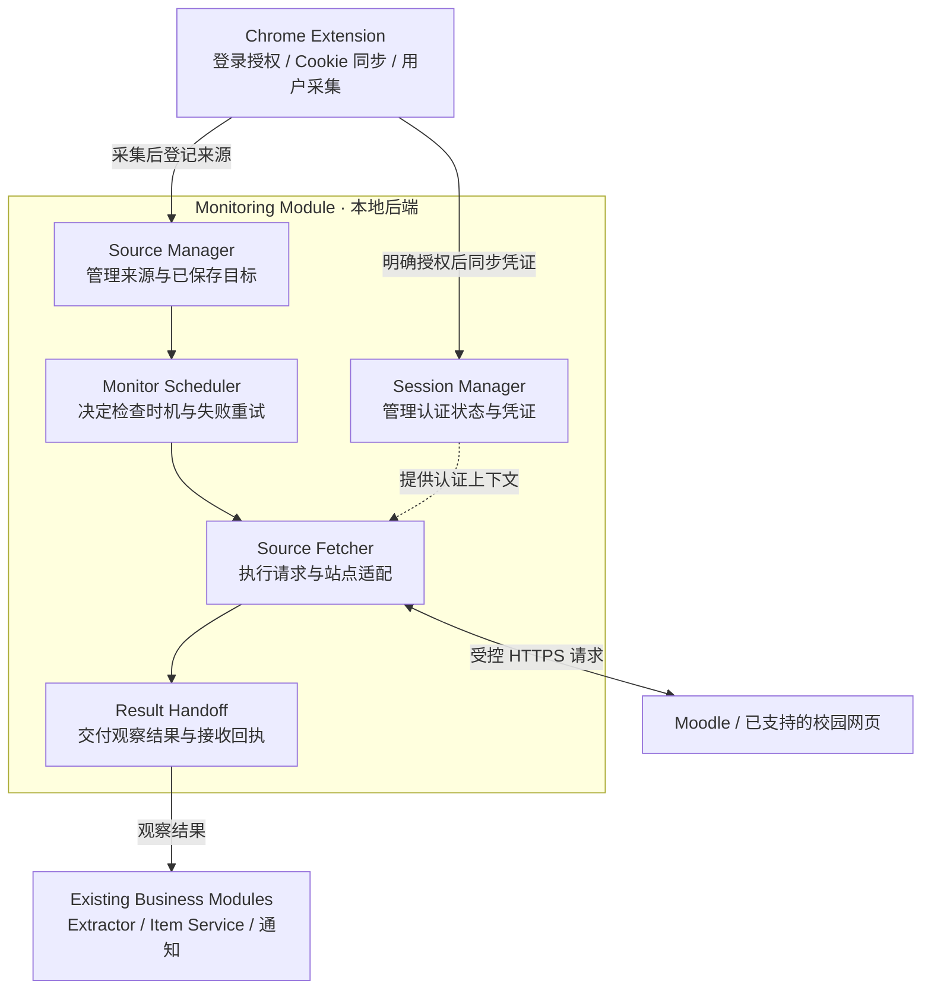
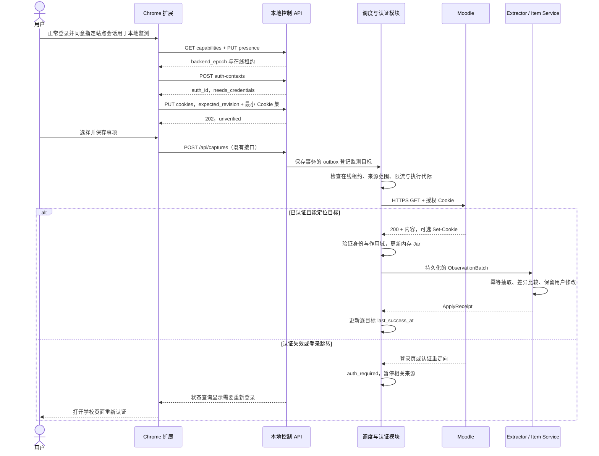
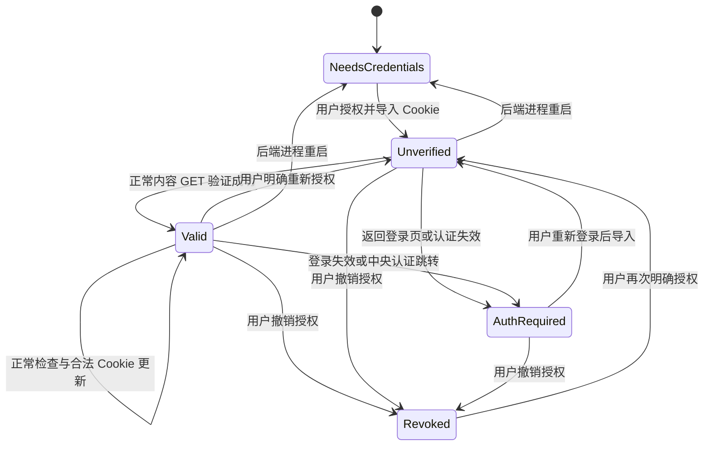

# Campus Radar｜Monitoring Module 架构设计

> 版本：v0.2（设计草案）｜更新：2026-11-07  
> 适用范围：Chrome Extension ↔ 本地后端 ↔ 信息源监测 ↔ 既有业务处理模块  
> 实施状态：本文件描述目标架构，**不表示新增接口、执行器或会话桥接已实现**。

相关契约仍保留在上级目录：[IC-003 监测模块接口](../IC-003-monitoring-module.md)；机器可读定义位于 [`docs/protocols/monitoring-v1.openapi.yaml`](../../protocols/monitoring-v1.openapi.yaml)。已有 [IC-001 插件采集接口](../IC-001-extension-to-backend.md) 和 [IC-002 工作台接口](../IC-002-backend-to-workbench.md) 继续有效。具体请求字段、状态码与幂等约束以接口契约为准。

## 1. 模块定位与设计目标

**定位：** 为学生已经选择并保存的校园信息提供可恢复、受权限约束的周期性来源检查；将获取到的内容交给既有业务模块做差异判断、版本记录与用户提示。

- **V1 要完成：** 用户在 Chrome 中登录并明确授权指定站点，后端根据已保存事项创建监测目标，定期请求允许的页面，维护会话状态，记录成功、失败和最后成功检查时间。
- **V1 运行边界：** Chrome 扩展已启用且能与本地后端通信、后端正在运行时尝试监测；不承诺 24 小时不间断、实时检查或关闭浏览器后的持续采集。
- **未来兼容：** 统一调度和来源管理可以复用至公开校园网页、其他学校 LMS、RSS 与内容订阅。每种来源可选择不同认证和内容适配方式；本次**不交付 YouTube 接入或任意网页订阅**。
- **职责限制：** 监测模块负责“何时检查、如何取得、是否成功取得”；事务分类、Deadline、Inbox、事项版本及用户修正归业务层处理。一个来源可能同时包含任务型和内容型条目。

**核心设计原则：** 让调度逻辑与站点认证、页面解析彼此解耦。Cookie 只是 V1 的一种认证策略，不应成为整个模块的中心抽象。

## 2. 总体架构与模块职责

这张图只展示**功能模块及关键依赖**。各模块初版是本地后端里的逻辑组件；不必拆成多个服务，也不需要专门部署消息队列。Chrome 向 Source Manager 的登记沿用现有 Capture API 保存流程，由后端完成实际登记。

| 功能模块 | 主要职责 | 明确排除的职责 |
|---|---|---|
| **Source Manager** | 管理来源、关联已保存事项、规范化 URL/locator、启停监测、提供允许的监测范围 | 不定时发网络请求，不判断作业类型 |
| **Session Manager** | 接收经授权的最小 Cookie 集、管理 Cookie Jar 与认证状态、识别需要重新登录、撤销授权 | 不收集学校密码，不自动执行 CAS 登录 |
| **Monitor Scheduler** | 选择到期来源、同页请求合并、分配运行租约、限流、退避、失败恢复 | 不直接解析 Moodle HTML，不修改事项业务字段 |
| **Source Fetcher** | 使用已有自研 HTTP 客户端执行 HTTPS GET；校验响应、重定向与认证；站点 Adapter 提取被监测目标的内容 | 不生成 Inbox、Deadline 或业务通知 |
| **Result Handoff** | 将 `ObservationBatch` 可靠交给现有处理模块，接收 `ApplyReceipt`，驱动监测结果落状态 | 不独立部署消息服务；不替业务层判定实质变化 |

## 3. 核心数据模型与职责边界

一个页面可能有多条用户保存的信息，因此**按 Source 抓取页面，按 Target 更新事项**。

| 对象 | 必需语义 | 状态所有者 |
|---|---|---|
| `MonitorSource` | 用户 + 适配器 + 规范化页面 + 可选认证上下文；定义一次抓取单元 | Source Manager / 后端持久层 |
| `MonitorTarget` | 已保存 `item_id` 与稳定 `locator`，绑定一个 Source；只监测用户明确保存的事项 | Source Manager；业务层拥有 `item_id` |
| `AuthContext` | 站点授权范围、浏览器实例与会话状态、凭证修订号/认证代际 | Session Manager |
| `Check` | 一次检查的来源、到期时间、结果、重试和执行代际 | Monitor Scheduler |
| `ObservationBatch` / `ApplyReceipt` | 请求成功后产生的逐目标观察，以及业务模块返回的实际应用回执 | Result Handoff ↔ 既有 Item Service |

数据边界需要明确：

1. **用户选择权：** V1 仅重新检查已经保存并启用监测的 `MonitorTarget`。同一页面新出现但用户从未保存的内容，不会自动创建个人事项。
2. **凭证隔离：** Session Manager 保存受控 Cookie Jar；Fetcher 使用认证上下文发请求。原始 Cookie 不进入解析、LLM、日志、通知或业务数据库。
3. **业务单写者：** Extractor / Item Service 负责事项去重、字段更新与来源版本；Fetcher 只产生观察。必须收到业务成功应用回执，才能更新对应 `last_success_at`。
4. **迟到结果保护：** `source.revision` 隔离配置或目标修改；`auth.generation` 隔离重新认证、撤销和账号切换；普通 `Set-Cookie` 轮换推进 `auth.revision`，不无谓废弃同一身份下的有效观察。
5. **可靠交接：** Result Handoff 在 V1 是进程内端口 + 本地事务队列的逻辑边界，用观察 ID 做幂等，不引入独立微服务。

历史 IC-001 的 `item_id` 与 `locator` 保持兼容。新监测 Source 使用独立 UUID 命名空间；旧插件 `GET /api/monitor/due` / `POST /api/monitor/results` 的执行权需与后端执行权隔离，以免重复抓取或迟到结果覆盖。详细迁移约束见 IC-003。

## 4. 网络技术与关键设计决策

| 通信环节 | 技术选择 | 关键理由 |
|---|---|---|
| Chrome → 本地控制接口 | **HTTP/1.1 + JSON**，复用现有本地 Bearer 鉴权 | 便于与原有 Capture API 协作；本地服务必须校验 Origin、Host 与身份，不能只依赖 CORS |
| 本地后端 → 校园站点 | **HTTPS GET**、DNS/TCP/TLS、连接复用、可控重定向 | 满足服务器只读访问与课程网络编程要求；沿用仓库自研 HTTP 客户端 |
| 会话 | **Cookie Jar + RFC 6265 子集**，保留 Domain、Path、Secure、HttpOnly、过期属性 | 需要在合法作用域内携带 Cookie，并处理网站的 `Set-Cookie` 轮换与失效 |
| 调度 | **asyncio + 持久化检查状态** | 单机任务规模足够，不增加分布式组件；睡眠、断线、重启能恢复 |
| 优化与异常 | HTTP 条件请求、超时、退避、`Retry-After`、同主机限速 | 控制上游负载与失败扩散；Moodle 初版优先完整 GET，不预设 304 可以延长会话 |
| 扩展 | `SiteAdapter` + 可替换认证策略 | Moodle HTML、公开校园网页、RSS/Feed 在相同任务框架下分别实现解析 |

网络安全门槛：对远端目标与**每一次重定向**都检查授权域名/路径、DNS 解析地址、TLS 主机名与私网地址限制；统一处理 Robots / 站点接入约束；包括 robots、重定向、重试在内的所有请求必须计入限流预算。当前仓库部分 Cookie Domain、`Retry-After` 与跳转限流行为需要在实施时加强。

暂时不按仓库 `CLAUDE.md`，服务端生产代码不复用 `server/gleaner/net/http/`，优先使用现成的网络库完成次功能。

技术参考：[R1 RFC 6265（Cookie）](https://www.rfc-editor.org/rfc/rfc6265.html)、[R2 Chrome cookies API](https://developer.chrome.com/docs/extensions/reference/api/cookies)、[R3 Chrome alarms 与 MV3 生命周期](https://developer.chrome.com/docs/extensions/reference/api/alarms)。

## 5. Chrome 与后端如何协作

扩展每分钟发出的心跳只访问本地后端，证明运行条件仍大致成立；它不请求学校网站，也不刷新学校会话。远端每十分钟的正常内容检查才可能更新服务端活动时间。

Chrome MV3 service worker 可以被回收，因此不依赖永久存活的 JavaScript 定时循环。使用 alarms 唤醒、持久化安装实例标识和递增心跳序号，并在启动时检查 alarm 是否存在。设备睡眠不会被 alarm 唤醒，恢复后的错过周期合并处理。[R2][R3]

## 6. 会话生命周期与权限

**最小 Cookie 集。** MUST 首版仅同步经验证的 Moodle 主机 Cookie；中央认证 SESSION、CAS ticket、学校密码均不进入后端。读取需 `cookies` 和对应 host 权限；HttpOnly 不代表扩展获得相应授权后仍无法通过 cookies API 读取。[R2]

**格式完整。** 保留 domain、path、hostOnly、secure、httpOnly、sameSite、session 与 expires_at。Cookie 的作用域不能简化成只有名称和值的字典。V1 拒绝分区 Cookie 和隐身配置；未来扩展需独立设计，不能静默丢掉隔离语义。[R1][R2]

**内存优先。** Cookie 值只驻后端内存；重启后向仍获授权的 Chrome 重新获取。插件自身不额外持久化学校 Cookie。后端无接口返回 Cookie。凭证不会进入日志、通知、快照、模型输入或 GitHub。

**双端会话关系。** 后端的 Cookie Jar 与 Chrome 的 Cookie Store 各自更新，但服务端可能把它们识别为同一会话。浏览器注销或轮换可能使后端副本失效。新 Cookie 不自动写回 Chrome；有效后端会话不接收插件周期性覆盖。用户明确重新登录后，才进行受版本保护的替换。

**退出与账号切换。** 用户撤销监测授权立即阻止新请求，清空内存凭证，使旧 generation 的任务无法写回。浏览器 Cookie 更新的 overwrite 删除事件需去抖重读，防止误判注销。换账号创建新上下文；无法可靠判断账号相同的重新导入，需要用户确认。

## 7. 故障处理与恢复

**区分四个阶段：请求完成 → 认证有效 → 目标解析成功 → 业务应用成功。** 其中任意一步失败，都不得把本次检查显示为“无变化”；仅业务应用成功更新对应目标的 `last_success_at`。

| 失败或边界场景 | 模块处理 | 对用户的影响 |
|---|---|---|
| HTTP `200` 但内容为登录页 / CAS 回跳 | Session 标记 `auth_required`，暂停依赖它的监测 | 提示重新登录；保留最后成功时间 |
| `403` 且没有认证失效证据 | 该来源记 `forbidden` | 显示权限不足，不注销其他来源 |
| `404` / `locator` 消失 / 结构变动 | Target 标记 `not_found` / `parse_failed`；不将空响应视为删除 | 旧事项和历史版本保留 |
| DNS、连接超时、TLS 错误、`5xx` | 有界重试、退避；达到阈值进入冷却 | 最近检查失败，历史数据仍可查看 |
| `429` 或 `Retry-After` | 延后最早请求时刻（同时识别秒数和 HTTP-date） | 等待下一次合法监测时间 |
| Chrome 关闭、租约过期、设备休眠 | 暂停派发新远端检查；恢复时合并到期轮次 | 显示等待浏览器，不伪造一次检查失败 |
| Cookie 更新、注销、切换账号 | 通过 `auth.revision` / `auth.generation` 做并发隔离；过期时请求重新授权 | 不把旧账号的观察结果写回新会话 |
| 后端重启 / 业务层暂不可用 | 重新获取插件授权会话；从本地事务队列重放未应用观察 | 不重抓不必要的远端页面；业务观察幂等 |
| 同页部分目标成功 | 按目标分别更新；来源级成功时间仅在全部启用目标成功时更新 | 成功与失败逐条可见 |

**状态分别建模：** `AuthContext` 使用 `needs_credentials / unverified / valid / auth_required / revoked`；`Source` 使用 `ready / waiting_browser / waiting_auth / paused / backoff / unsupported`；`Check` 另有 `changed / unchanged / partial / failed / superseded` 等结果。来源“暂时未运行”和“检查已失败”需保持可区分。

同一 Source 的并发检查互斥，手动检查同样进入调度与限流队列。发生配置更改或重新认证时，对旧代际结果进行 `superseded` 处理。监测层只交付可审计的观察；用户修改和来源版本冲突由既有业务层决定。

## 8. 参数设置

所有值均为 **V1 建议初始配置**，实施前须通过 `fake_moodle` 和授权范围内的人工验证确认。学校接入规则、服务端 `Retry-After` 和更严格的访问政策优先于用户设置。

### 8.1 推荐的系统参数

| 参数名（建议） | 默认值 | 控制对象与说明 |
|---|---|---|
| `monitor.default_interval_s` | `600` | 已保存来源的正常检查间隔；同一个校园测试账号不得短于登记的 10 分钟 |
| `monitor.min_host_gap_s` | `2` | 同主机请求起始间隔下限；包含 robots、重定向和重试请求 |
| `monitor.max_per_host_inflight` | `1` | 单主机最大并发执行数 |
| `monitor.max_global_inflight` | `4` | 全局同时发起请求的上限 |
| `monitor.bridge_heartbeat_s` | `60` | Chrome 通过 alarms 向本地后端发送在线信号，不访问学校 |
| `monitor.bridge_lease_s` | `180` | 最近有效心跳之后允许派发新任务的时间窗口 |
| `monitor.connect_timeout_s` | `10` | TCP/TLS 连接建立超时预算 |
| `monitor.request_timeout_s` | `30` | 单次远端请求总时限（包含跳转链） |
| `monitor.max_redirects` | `3` | 允许的最大重定向跳数；每跳重新做范围与地址校验 |
| `monitor.retry_limit` | `2` | 一次失败后的最大调度重试次数，必须遵守下一次允许窗口 |
| `monitor.circuit_failures` | `3` | 同源连续网络检查失败次数达到该值进入冷却 |
| `monitor.circuit_cooldown_s` | `1800` | 熔断冷却时长；之后只允许试探一次 |
| `monitor.max_response_bytes` | `4194304` | 线上传输的压缩数据最大 4 MiB（解压前） |
| `monitor.max_decoded_bytes` | `8388608` | 解压后的最大正文：8 MiB |
| `monitor.max_cookie_import_bytes` | `262144` | 特权 Cookie 导入请求体最大 256 KiB |

### 8.2 参数的控制层级

| 级别 | 管理内容 | 原则 |
|---|---|---|
| **系统级** | 全局并发、响应大小、连接超时、Cookie 导入限制 | 由开发配置决定；不交给用户绕过安全门槛 |
| **站点适配器级** | 允许的域名与路径、认证方案、解析方式、站点最低请求间隔、已验证会话提示 | 必须经过接入验证；站点强制约束只能收紧 |
| **来源级** | 是否启用监测、用户希望的检查间隔、目标集合 | V1 首先开放启停；高级频率自定义可放 P1 |
| **运行态** | 下一次允许请求时间、失败次数、重试期限、在线租约、会话有效性 | 系统自动计算；不能直接作为用户可编辑配置 |

### 8.3 Cookie 与会话参数的特殊处理

目前的 Moodle 观察支持：普通课程 GET 可以影响会话活动时间；站点页面曾出现 `sessiontimeout=7200` 的提示。该数值应记录为 `idle_timeout_hint_s = 7200` 的**观测提示**，**不能直接写成 Cookie 的固定有效期**，更不能由此承诺每次请求都能无限续期。

- **正常监测优先：** 通过实际内容 GET 检查来源；不增设专门为了永久保活而定时访问学校的请求。
- **验证优先：** `Set-Cookie` 只提供客户端会话信息；还要通过实际响应判断服务器端身份状态。`200` 的登录页不算监测成功。
- **同步边界：** Chrome 仅在用户授权、首次导入、失效恢复时提供最小 Cookie 集；不持续用浏览器里的旧值覆盖后端较新的 Cookie Jar。
- **扩展兼容：** 公开网页的 `auth=none`；其他网站认证策略、分区 Cookie、OAuth 等必须单独适配与验证；未来接入 YouTube 不应默认导出 Google 登录 Cookie。

参数的具体配置文件路径、用户设置 UI 与接口字段应在实施时对齐 [IC-003](../IC-003-monitoring-module.md)，避免同时维护两份相互矛盾的契约。
